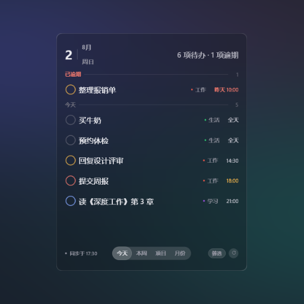

# Tasks for TickTick — SnowDesktop 组件

中文名「滴答清单任务板」。一个 [SnowDesktop](https://snowdesktop.com/) 桌面组件：把滴答清单（dida365.com）或 TickTick（ticktick.com）的待办放到桌面上——今天要做什么、哪件逾期了、这周怎么排，勾一下就能完成。

<p align="center"></p>

> 非官方组件，与 TickTick / 滴答清单无隶属关系。

## 功能

- **四个视图**，底栏胶囊切换：
  - **今天**：逾期置顶（红色分组），然后是今天；空的时候会告诉你下一条待办是什么。
  - **本周**：按天分组，今天 / 明天 / 周几，每天带计数。
  - **项目**：按列表分组，看板项目（kanban）会显示自己的「板块」列，未分栏的任务归到「未分栏」。
  - **月份**：按自然月分组，没有截止日期的任务收在最后，不会凭空消失。
- **勾选完成**：点圆环立刻划掉（乐观更新），同时写回服务器；失败会自动恢复该行并提示。
- **手动刷新**：底栏右侧的刷新按钮；也支持 60–3600 秒的自动刷新间隔。
- **滚动**：任务多时滚轮上下滚动，滚动条由宿主绘制，半露出的行不会抢走底栏点击。
- **筛选**：底栏「筛选」打开列表面板，可按文件夹整组开关，也可以逐个列表勾选；隐藏数量显示在胶囊上。
- **排序**：截止时间 / 优先级 / 手动顺序 / 分类，四种模式。
- **外观**：磨砂 / 实色 / 透明三种预设，跟随系统深浅色；文字颜色跟随宿主解析出的前景色，不会白底白字。
- **紧凑模式**：压到一行高度（3×1）时变成状态条：日期、计数和下一条任务。
- **中英双语**：界面跟随宿主语言。

## 安装

### 从文件安装（推荐）

1. 到本仓库的 [Releases](../../releases) 下载最新的 `ticktick-tasks.snowwidget`。
2. SnowDesktop → **设置 → 组件 → 从文件安装…**，选择该文件。
3. 首次添加会请求 **网络访问权限**（组件要读取你的任务列表）。

### 作为开发组件

把仓库内容（`widget.json`、`main.lua`、`modules/`、`tests/`、`preview.png`、`previews/`）放进：

```
<SnowDesktop 安装目录>\data\widgets\dev\ticktick-tasks\
```

然后在 **设置 → 组件 → 添加组件** 里找到「滴答清单任务板」。开发目录的改动会即时生效。

## 连接滴答清单

1. 打开 [dida365.com](https://dida365.com) 并登录。
2. 右上角头像 → **设置 → 账户与安全 → API 令牌 → 生成新令牌**。
3. 复制令牌，粘贴到组件设置里的 **API 令牌**。

不需要开发者工具，不需要 cookie。令牌保存后几秒内组件就会连上，并在看板上弹出「已连接 · N 项任务」。

国际版账号：在组件设置里把 **服务区域** 切到 `TickTick（国际）`，然后粘贴 ticktick.com 的 API 令牌。两个区域的账号和令牌互不通用。

## 数据来源与隐私

- 只用官方 **Open API**（`api.dida365.com` / `api.ticktick.com`），读取项目列表和每个项目的任务。
- 唯一的写操作是 **完成任务**（`POST /open/v1/project/{p}/task/{t}/complete`），不会修改标题、日期或其它字段。
- 令牌以 **DPAPI 密文**由宿主保存，组件代码只拿到一个不透明引用，请求时由宿主注入 `Authorization` 头。令牌不会进入 Lua、存储文件、日志或预览渲染。
- 无遥测、无第三方服务、不访问声明的两个域名以外的地址。

## 已知限制

- **收集箱读不到**：官方 Open API 不返回收集箱里的任务。如果收集箱是你的主列表，请把任务挪进普通列表。
- **文件夹名**：官方接口只给 `groupId`，不给文件夹名。可以在设置里填一次「文件夹名称」，筛选面板会用它作为分组标题。
- **删除组件后要重贴令牌**：宿主的密文按组件实例隔离，删掉组件再添加会得到新的实例，需要重新粘贴一次令牌；普通重启不受影响。
- **超大列表**：沙箱对单次回调有执行配额。某个列表任务特别多（大约 150 条以上、且带长笔记）时，这一个列表本轮会跳过，底栏显示「部分同步」，其它列表照常显示；下一轮会再试。
- 需要 **SnowDesktop 1.0.15.0** 或更新版本。

## 开发

数据层（`modules/`）不依赖宿主 API，可以在命令行里直接跑测试：

```bash
snowwidget lint   <package-dir>
snowwidget test   <package-dir>     # 24 例：解析、分组、排序、筛选、预览数据
snowwidget preview <package-dir> out.png --columns 4 --rows 5 --locale zh-CN
snowwidget quality <package-dir>
snowwidget pack   <package-dir> ticktick-tasks.snowwidget
```

- `main.lua` 负责布局与交互：`buildFrame()` 一次算出几何与字号，`drawHeader / drawRows / drawFooter / drawNotice / drawFilterBoard` 各画一块。
- `modules/ticktick.lua` 是纯函数投影层：日期解析、任务/项目归一化、四种视图的 compose。
- `modules/json.lua` 是带 `skip` 的受限 JSON 解码器——沙箱没有 JSON 库，跳过字段是让大响应留在执行配额内的关键。
- 预览数据在 `widget.json` 的 `previewData.storage.previewTasks`，格式 `标题|列表|#颜色|优先级|日偏移|全天|HH:MM`，用 `;` 分隔（预览数据里的换行会被转义坏）。

## 更新日志

见 [CHANGELOG.md](CHANGELOG.md)。

## License

[MIT](LICENSE)

---

**English**: An unofficial SnowDesktop widget for TickTick / Dida365. Four boards (today, week, lists with kanban columns, months), optimistic completion, scroll, list filter, and three material presets. It talks to the official Open API with a personal API token stored as a DPAPI secret by the host — no cookies, no telemetry.
